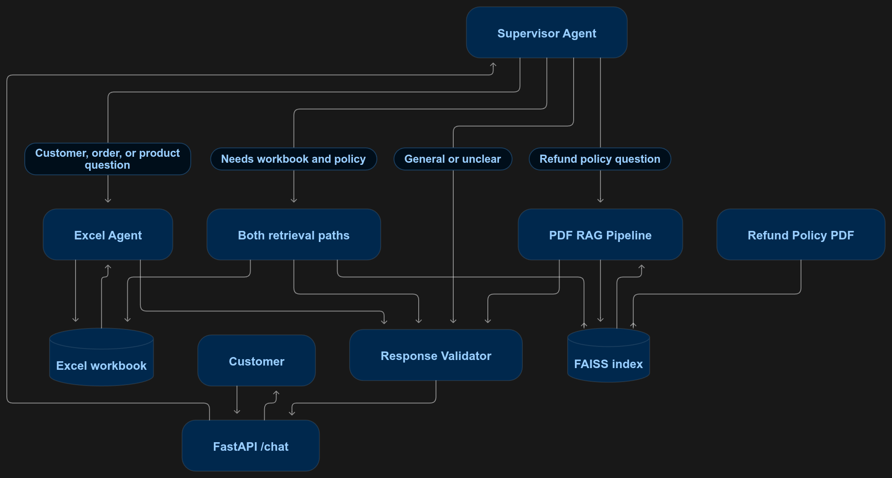
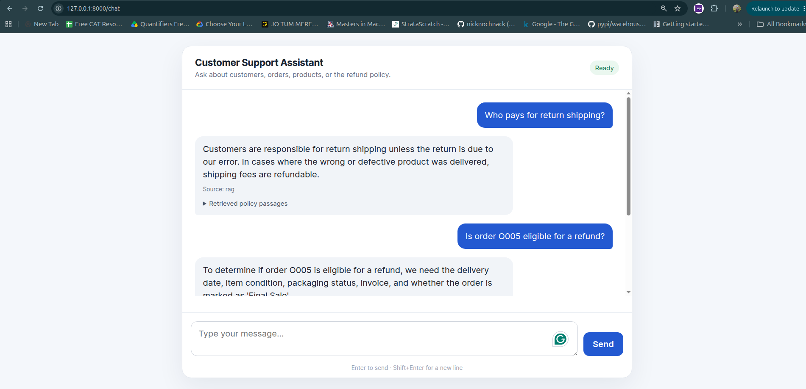
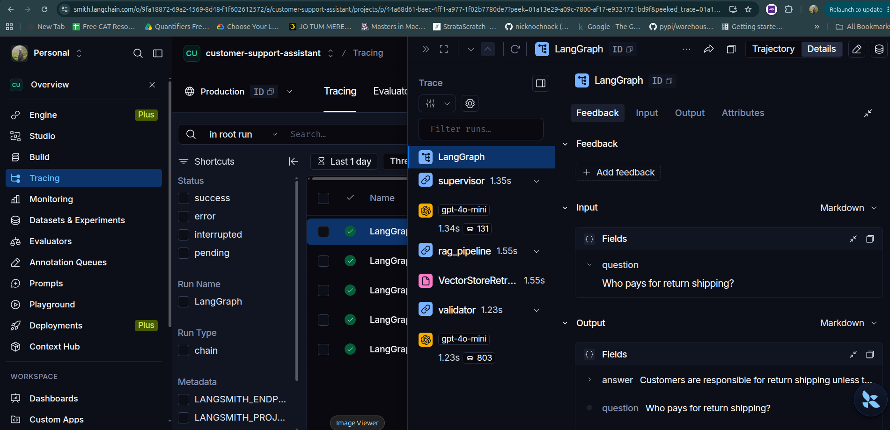

# Customer Support Assistant

A small customer support API built with **FastAPI**, **LangGraph**, Excel lookups, and **FAISS RAG** over the refund policy PDF. The supervisor chooses the Excel agent, the PDF RAG pipeline, or both. A single validator prepares the response from the retrieved material.


## Architecture



## Workflow and technology

1. FastAPI validates the question and calls the LangGraph workflow.
2. The supervisor uses structured LLM routing, with a keyword fallback if routing fails.
3. The Excel agent looks up customer, order, and product IDs in the workbook. It joins order rows with related customer and product rows.
4. The PDF RAG pipeline searches policy passages in FAISS. Questions that require both sources run both retrieval steps.
5. One response validator uses the facts and passages to answer, reports missing facts, and avoids unsupported conclusions.
6. FastAPI returns the answer, selected route, workbook facts, and policy excerpts.

- **FastAPI + Uvicorn** provide the HTTP API.
- **LangGraph** defines the supervisor, retrieval paths, and validator.
- **LangChain OpenAI integration** provides structured routing, response generation, and embeddings.
- **FAISS + PyPDF** index and retrieve excerpts from the refund policy PDF.
- **openpyxl** reads the Excel worksheets.

## Chat Interface



## LangSmith monitoring

The app supports LangSmith tracing for LangGraph runs, model calls, and PDF retrieval. Copy `LANGSMITH_API_KEY` from your [LangSmith settings](https://smith.langchain.com/) into `.env`, and set `LANGSMITH_TRACING=true`. Traces are grouped under the `LANGSMITH_PROJECT` name (default: `customer-support-assistant`). `LANGSMITH_ENDPOINT` defaults to the LangSmith SaaS endpoint.

The trace can include the user's question, generated response, retrieved policy text, and Excel facts used to answer. Use sample or appropriately approved customer data when sending traces to LangSmith.



## Data limitations

The sample `Orders` sheet has `OrderDate`, `Quantity`, `Amount`, and `Status`. It does not have delivery date, product condition, final-sale status, proof of purchase, or report date. The policy measures the standard refund window from delivery. For an individual order, the validator calls out missing facts and does not treat the order date as the delivery date. The workbook also has no premium-membership field.

## Setup

```bash
python3 -m venv venv
source venv/bin/activate       # Windows: venv\Scripts\activate
pip install -r requirements.txt
cp .env.example .env
mkdir -p data
cp Sample_Customer_Data.xlsx Detailed_Sample_Refund_Policy.pdf data/
```

Set `OPENAI_API_KEY` in `.env`. For monitoring, also add your `LANGSMITH_API_KEY` and set `LANGSMITH_TRACING=true`. On first startup, the app reads the PDF, creates embeddings, and saves the FAISS index in `data/faiss_index/`. The OpenAI key needs access to the configured chat and embedding models. To use other source paths, set `CUSTOMER_WORKBOOK` and `REFUND_POLICY_PDF` in `.env`. To rebuild the index after changing the PDF, remove the index directory and restart.

## Run

```bash
uvicorn app.main:app --reload
```

The chat interface is available at `http://localhost:8000/chat` (the root URL redirects there). Visit `http://localhost:8000/docs` for interactive API documentation. Health check: `http://localhost:8000/health`. For a separately hosted local frontend, the API accepts CORS requests from `localhost`, `127.0.0.1`, and `0.0.0.0` origins on any port, including Chrome private-network preflight requests.

## Run with Docker

Set `OPENAI_API_KEY` in the project `.env` file. Add `LANGSMITH_API_KEY` and set `LANGSMITH_TRACING=true` to enable monitoring. Then build and start the container:

```bash
docker compose up --build -d
```

Docker exposes the app at `http://localhost:8000`. The FAISS index persists in a Docker volume. Stop the service with:

```bash
docker compose down
```

## Example

```bash
curl -X POST http://127.0.0.1:8000/chat \
  -H 'Content-Type: application/json' \
  -d '{"question":"Is order O005 eligible for a refund?"}'
```

Other sample prompts:

- `Show the profile for customer C005.`
- `What orders does customer C005 have?`
- `What is the unit price for product P001?`
- `How long does an approved refund take to process?`
- `Who pays return shipping if the item arrived defective?`

Response format:

```json
{
  "answer": "...",
  "route": "both",
  "facts": ["Order O005: ..."],
  "evidence": ["Retrieved policy passage..."]
}
```

`POST /chat` accepts `{"question":"..."}`. The included workbook and policy contain sample assessment data; replace them with approved sources before using the app outside the assessment.
